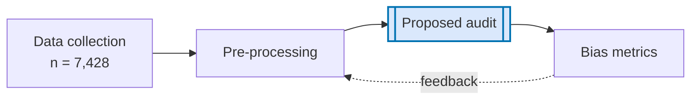

# Diagram and chart tools (all free, no API key)

Pick the tool by the figure type and the user's workflow:

| Figure | Default tool | Alternative |
|---|---|---|
| Framework, pipeline, architecture, swimlane | draw.io XML (`.drawio`) | Mermaid `flowchart LR`, TikZ |
| Empirical methodology pipeline | `scripts/pipeline_drawio.py` | draw.io by hand |
| Review search and selection (double-stage) | `scripts/double_stage_drawio.py` | |
| Bibliometric PRISMA selection flow | `scripts/selection_flow_drawio.py` | |
| Classic PRISMA 2020 | `scripts/prisma_drawio.py` | Mermaid |
| Taxonomy tree | draw.io (tree layout) | Mermaid `mindmap` or `flowchart TB` |
| Timeline | Mermaid `timeline` | draw.io |
| Data charts | matplotlib + `assets/paper_style.py` | seaborn on top of the same style |
| Networks (bibliometric) | Export from VOSviewer / Biblioshiny at high resolution | networkx + matplotlib for custom ones |

Deliver the source file. Users can edit `.drawio` files at https://app.diagrams.net (free, runs in the browser) and export them to PDF, PNG or SVG.

## 1. draw.io XML

Minimal structure. Cells `0` and `1` are required. Every other cell is a vertex (box) or an edge (arrow).

```xml
<mxfile host="sss-team-research-skill">
  <diagram name="Framework">
    <mxGraphModel grid="1" gridSize="10" page="1" pageWidth="1100" pageHeight="500">
      <root>
        <mxCell id="0"/>
        <mxCell id="1" parent="0"/>
        <mxCell id="data" value="Data collection&lt;br&gt;(n = 7,428 prompts)" style="rounded=1;whiteSpace=wrap;html=1;fillColor=#F5F5F5;strokeColor=#666666;fontSize=12;" vertex="1" parent="1">
          <mxGeometry x="40" y="160" width="160" height="70" as="geometry"/>
        </mxCell>
        <mxCell id="model" value="&lt;b&gt;Proposed audit&lt;/b&gt;" style="rounded=1;whiteSpace=wrap;html=1;fillColor=#DAE8FC;strokeColor=#0072B2;strokeWidth=2;fontSize=12;" vertex="1" parent="1">
          <mxGeometry x="260" y="150" width="190" height="90" as="geometry"/>
        </mxCell>
        <mxCell id="e1" style="endArrow=block;html=1;strokeColor=#333333;" edge="1" parent="1" source="data" target="model">
          <mxGeometry relative="1" as="geometry"/>
        </mxCell>
      </root>
    </mxGraphModel>
  </diagram>
</mxfile>
```

Rules for writing it:
- Give every cell a unique, readable `id` (for example `data`, `model`, `eval`).
- Escape HTML inside `value`: `&lt;br&gt;` for a line break, `&amp;` for &.
- Lay boxes out on a grid (x and y in multiples of 10). Leave 50-60 px gaps between stages in a left-to-right pipeline.
- Group a stage with a container: a large rounded rectangle with `dashed=1;fillColor=none;` and the label at the top (`verticalAlign=top;`).
- Colours: grey `#F5F5F5`/`#666666` for standard parts, and one accent (blue `#DAE8FC`/`#0072B2`, thicker stroke) for the contribution. Use orange `#E69F00` sparingly for a second category.
- Arrow semantics: solid `endArrow=block` = data flow; `dashed=1` = feedback or optional; `dashed=1;dashPattern=1 3` = human-in-the-loop. Put the meaning in the caption.
- Check the file is well-formed XML before you deliver it (for example with `python -c "import xml.dom.minidom,sys; xml.dom.minidom.parse(sys.argv[1])" file.drawio`).

`assets/pipeline-template.drawio` is a ready 5-stage pipeline (Data, Pre-processing, Model, Evaluation, Output). Copy it and rename the labels.

## 2. PRISMA script

```bash
python scripts/prisma_drawio.py --out prisma.drawio \
  --identified "Scopus=1048" --identified "Web of Science=512" \
  --duplicates 300 --other-removed 12 --screened 1248 --excluded-screening 980 \
  --sought 268 --not-retrieved 6 --assessed 262 \
  --excluded-reason "Off-topic=120" --excluded-reason "No empirical evaluation=40" \
  --other-sources 6 --included 108
```

The script checks that each box equals the one above minus its exclusions, and it refuses to write a diagram that does not add up. This catches the most common reviewer complaint about PRISMA figures. If the user's counts do not add up, show them the error, not a diagram.

## 3. Mermaid (when the user wants text-based diagrams, Markdown or GitHub)



The draw.io web app can import Mermaid (Arrange > Insert > Advanced > Mermaid), so users can start in Mermaid and polish in draw.io.

## 4. TikZ (for LaTeX users)

Use `\usetikzlibrary{positioning,arrows.meta}`, define the node styles once (`box/.style={draw, rounded corners, minimum width=2.6cm, minimum height=1cm, align=center}`), and place nodes with `right=1cm of ...`. Keep the font at `\small` so it matches the paper.

## 5. matplotlib charts

```python
import sys, pandas as pd, matplotlib.pyplot as plt
sys.path.insert(0, "path/to/skill/assets")
from paper_style import apply, save, COL_W
apply()
df = pd.read_csv("results.csv")            # the user's real data, never invented
fig, ax = plt.subplots(figsize=(COL_W, 2.4))
ax.bar(df["model"], df["f1_mean"], yerr=df["f1_sd"], capsize=2)
ax.set_ylabel("Macro-F1 (↑)"); ax.set_ylim(0, 1)
save(fig, "fig3_results")                 # fig3_results.pdf + .png
```

Common recipes:
- **Annual output (bibliometric):** bars for publications, `ax.twinx()` line for citations, and a lighter shaded final bar labelled "(partial year)".
- **Grouped bars:** `x = np.arange(len(models))`, then offset each metric by the bar width. Add error bars when there are several runs.
- **Heatmap:** `ax.imshow(M, cmap="viridis")` with the value written in each cell, and a colourbar with its label.
- **Confusion matrix:** `sklearn.metrics.ConfusionMatrixDisplay`, normalised by row, with a note in the caption.

If you cannot run code in this environment, give the script and say exactly how to run it (`python fig3.py`, which needs `pip install matplotlib pandas` or `uv pip install ...`).
